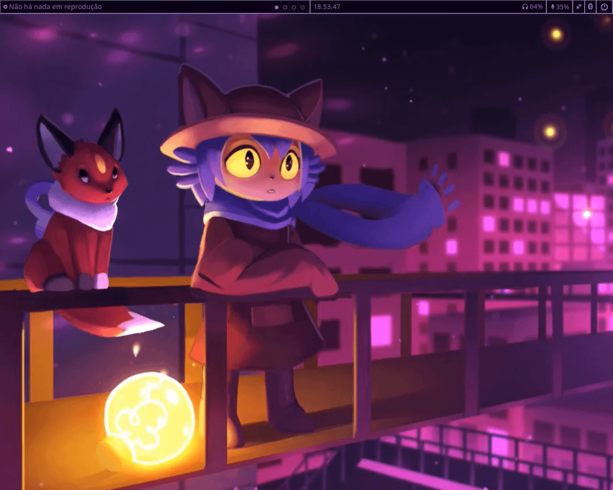
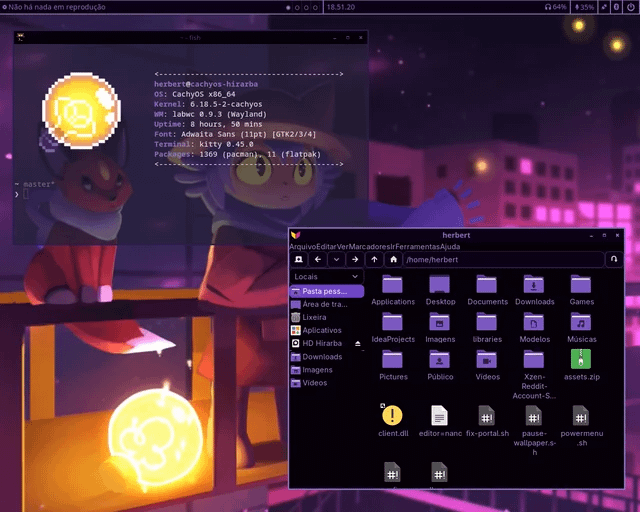
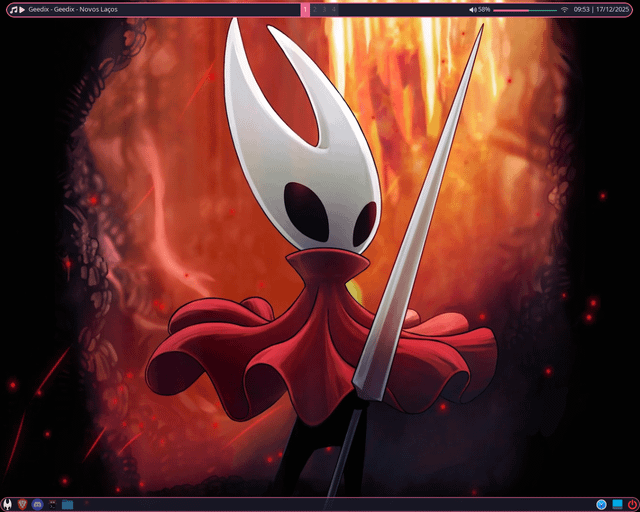
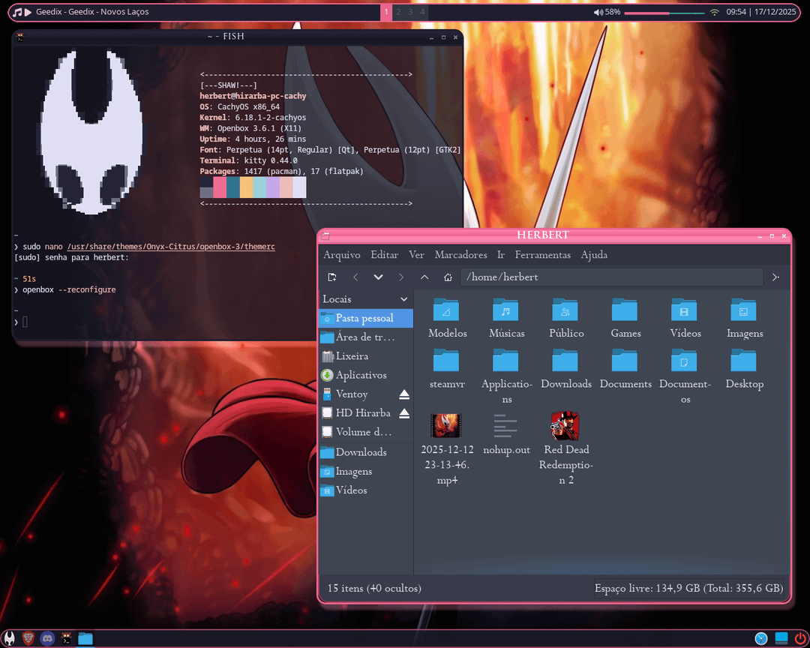
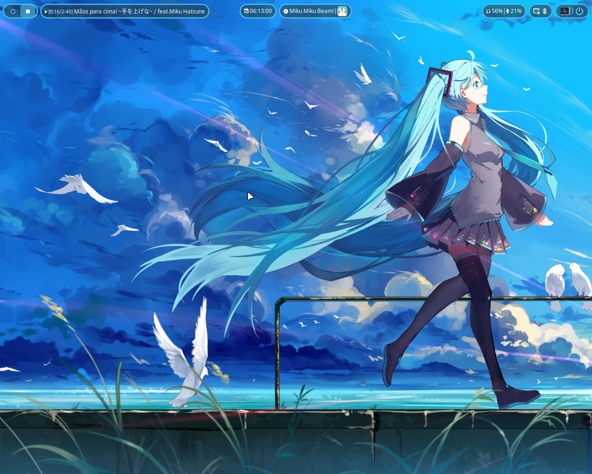
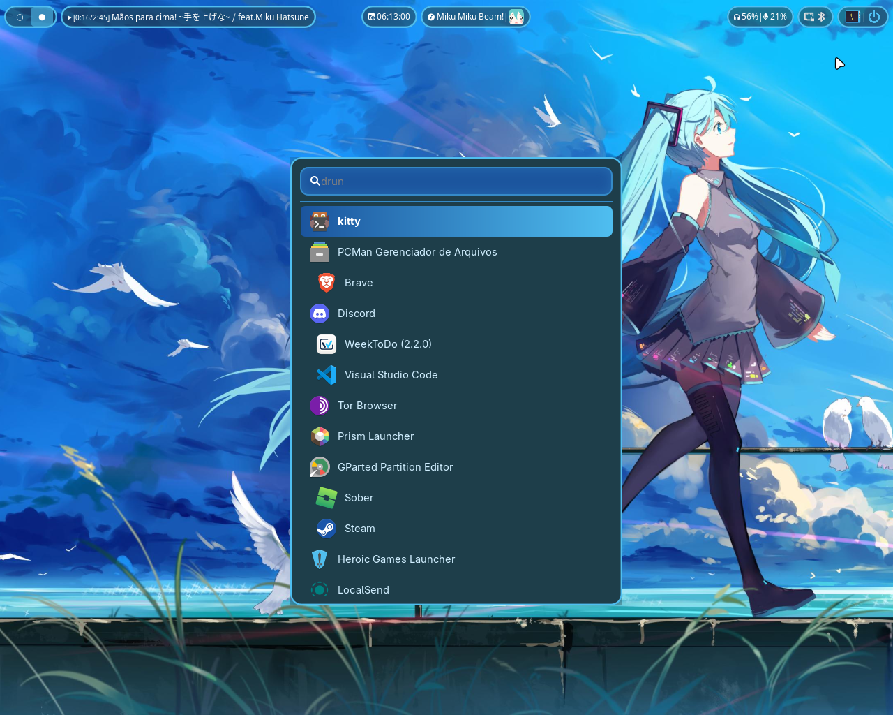
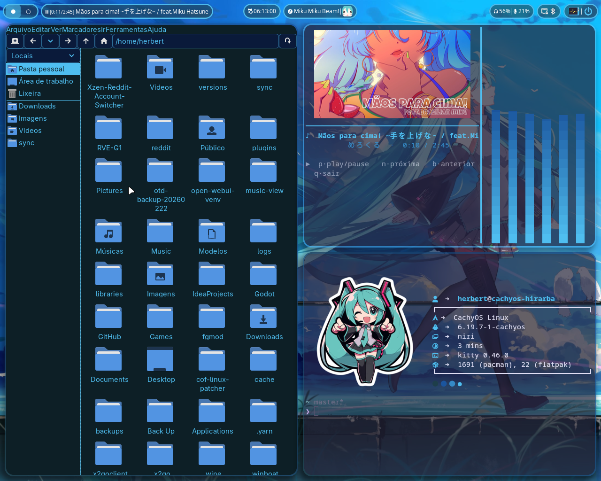
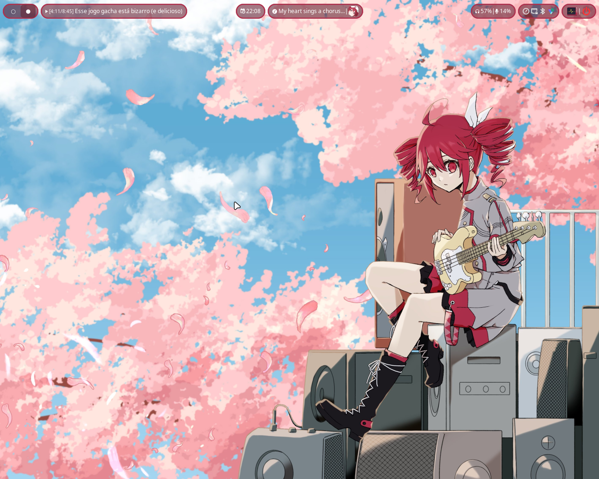
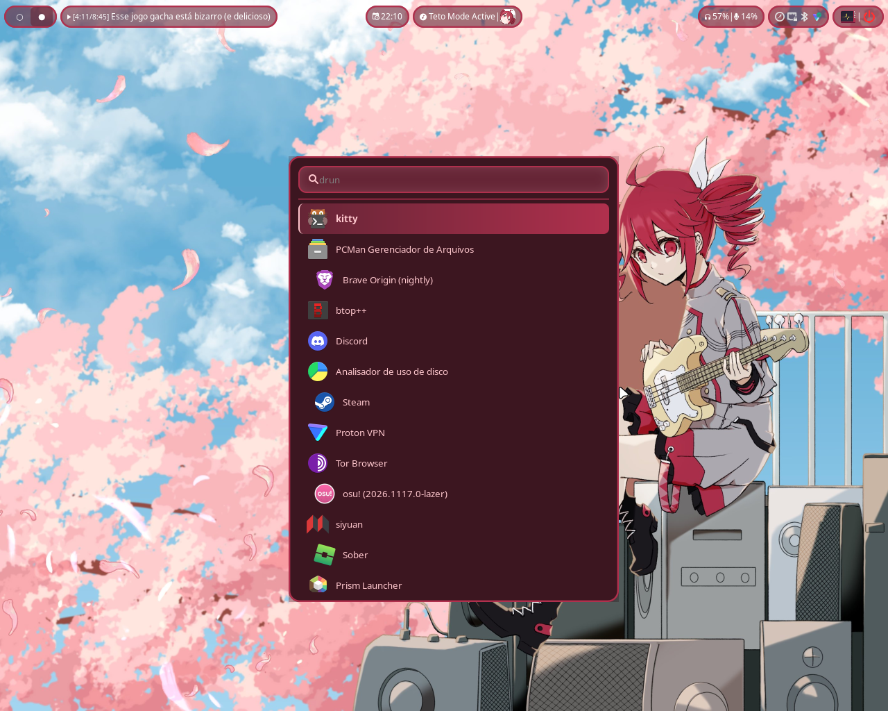
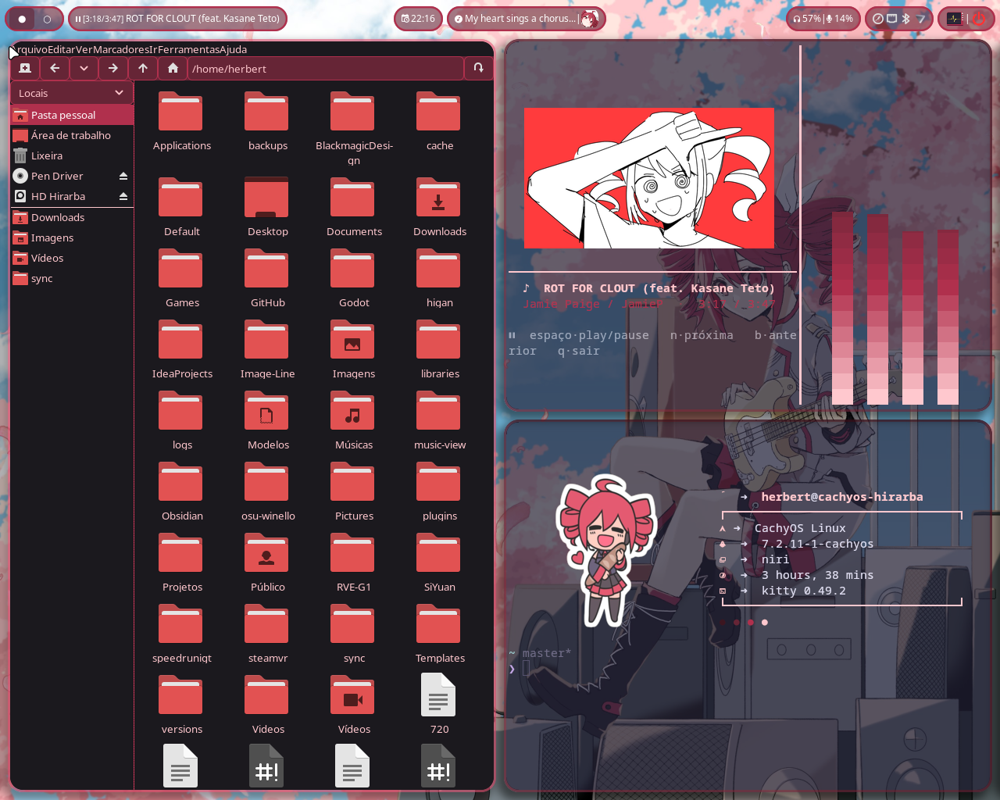

# 🐧 My Dotfiles

Dottfiles of my personal linux desktops!

Feel free to fork and use as you want.

---

### 📸 Screenshots

  <table>
    <tr>
      <td valign="top" align="center">
        
         <b>Labwc</b>
      </td>
      <td valign="top" align="center">
        
         <b>Labwc workflow</b>
      </td>
      <td valign="top" align="center">
        
         <b>Openbox</b>
      </td>
      <td valign="top" align="center">
        
         <b>Openbox workflow</b>
      </td>
    </tr>
    <tr>
      <td valign="top" align="center">
        
         <b>Niri (Miku)</b>
      </td>
      <td valign="top" align="center">
        
         <b>Niri (Miku) Wofi</b>
      </td>
      <td valign="top" align="center">
        
         <b>Niri (Miku) workflow</b>
      </td>
    </tr>
    <tr>
      <td valign="top" align="center">
        
         <b>Niri (Teto)</b>
      </td>
      <td valign="top" align="center">
        
         <b>Niri (Teto) Wofi</b>
      </td>
      <td valign="top" align="center">
        
         <b>Niri (Teto) workflow</b>
      </td>
    </tr>
  </table>

---

### 🛠️ Current desktops
* **LabWC** 
* **OpenBox**
* **Niri**

### ‼️ Disclaimer

I used AI to help me do some parts of the styles.css, changing the colours and matching the parts, to do the GTK themes and code the music-view. Nonetheless, the other parts, the waybar configuration and all the images are completely human made.